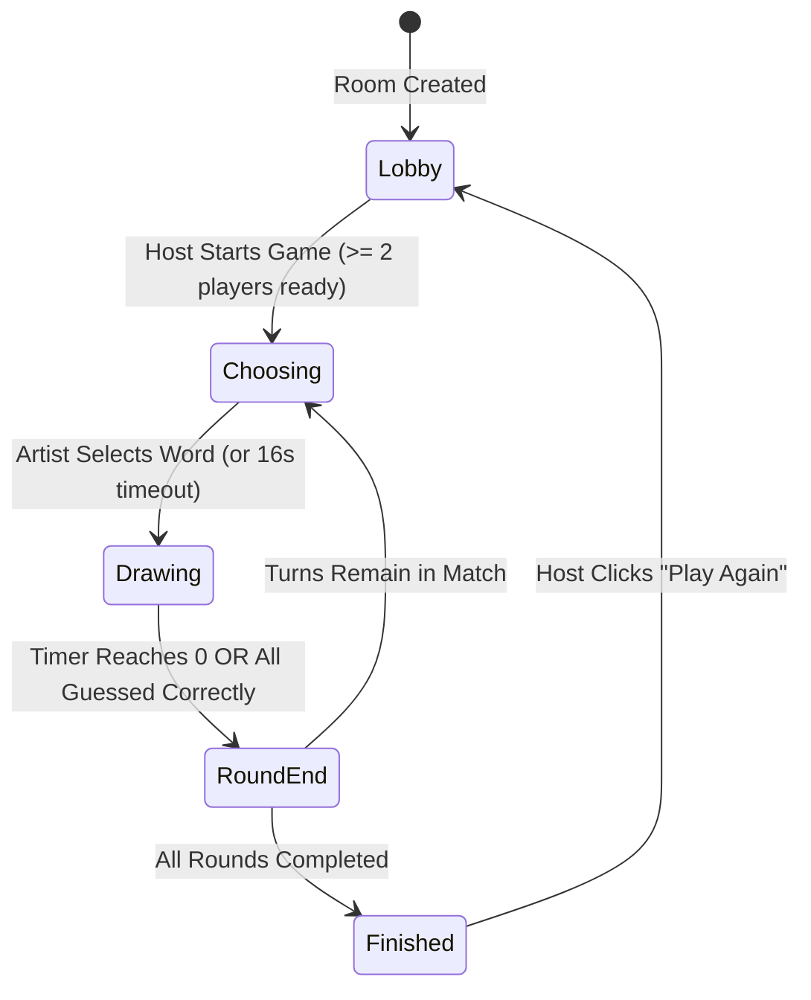

# ✏️ Pencilly — Real-Time Multiplayer Drawing & Guessing Game

<div align="center">

[](https://www.typescriptlang.org/)
[](https://react.dev/)
[](https://vitejs.dev/)
[](https://nodejs.org/)
[](https://expressjs.com/)
[](https://socket.io/)
[-success)](./server/test)

**A high-performance, server-authoritative multiplayer drawing-and-guessing game built with React, HTML5 Canvas, Express, and Socket.IO.**

[Architecture](#-system-architecture) • [Quick Start](#-quick-start) • [Game Mechanics](#-game-rules--scoring-mechanics) • [API & Sockets](#-api--socketio-specification) • [Testing](#-automated-testing-suite) • [Production Deployment](#-production-deployment)

</div>

---

## 🌟 Overview

**Pencilly** is a full-stack multiplayer drawing and guessing game. Players join public or private rooms, take turns sketching randomly generated words on a synchronized HTML5 canvas, and compete by guessing words in real-time chat.

The application is built around **server authority, strict room isolation, low latency, and cross-platform compatibility** across desktop browsers, smartphones, and tablets.

---

## ✨ Key Features

### 🎨 Responsive Canvas & Cross-Device Input
- **Universal Input Layer**: Built with HTML5 Pointer Events (`onPointerDown`, `onPointerMove`, `onPointerUp`, `onPointerCancel`) to natively support **mouse, touch gestures, and active stylus pens** (Apple Pencil, S-Pen, Surface Pen).
- **Normalized Coordinates**: Real-time points are mapped to a unit interval $[0.0, 1.0]$. Whether viewed on a 4K monitor, an iPad, or a mobile viewport, all drawing coordinates scale with geometric fidelity.
- **Uniform Stroke Rendering**: Line rendering is device-agnostic, ensuring every spectator sees the exact same drawing regardless of hardware differences.
- **Gesture Protection**: Explicit `touch-action: none` and Pointer Capture prevent mobile rubber-banding, inadvertent page scrolling, and pinch-to-zoom disruptions during sketches.
- **Tools & Controls**: 12 curated artist palette swatches, pen/eraser toggles, adjustable brush radius (2–28px), local optimistic rendering, global undo (`Ctrl+Z`), and synchronized canvas wipes.

### 🌓 Human-Crafted UI & Theme Support
- **Dark & Light Mode**: Native theme toggle with persistent state across all screens.
- **Single-Page Room Setup**: Focused room creator with zero vertical scrolling, quick 1-click presets, and clearly legible, high-contrast controls.
- **Cozy Match Lobby**: Warm studio aesthetic with matching background graphics (`studio-room.svg`), warm parchment cards, and clear typography.

### 🕹️ Server-Authoritative Game Engine
- **Deterministic State Machine**: Managed on the server with transitions:
  $$\text{Lobby} \longrightarrow \text{Choosing} \longrightarrow \text{Drawing} \longrightarrow \text{Round End} \longrightarrow \text{Finished / Results}$$
- **Anti-Cheat & Secret Word Privacy**: The secret word is never broadcast over public sockets or exposed in DOM trees during guessing rounds. The artist receives the word via private emission (`secret_word`), while guessers receive masked blanks (`wordMask`, e.g., `_ _ _ _ _`).
- **Dynamic Hints**: Letters reveal automatically at calibrated intervals during normal rounds without exposing the complete answer.
- **Fail-Safe Turn Timeouts**: Automatic 16-second countdown for word selection and turn duration timers (`timer_tick` emitted every 1,000ms).

### 🏆 Dynamic Scoring & Leaderboards
- **Speed-Weighted Guesser Points**: Up to $250$ points per turn ($100$ base + up to $150$ speed bonus calculated via $\text{round}(150 \times \frac{t_{\text{remaining}}}{t_{\text{draw}}})$).
- **First-to-Guess Bonus**: $+40$ bonus points awarded to the first correct guesser in each round.
- **Artist Reward**: $+45$ points awarded to the drawer for each player who successfully identifies their drawing.
- **Podium & Standings**: End-of-round score recaps and podium standings at match conclusion with 1-click room replay.

### 🛡️ Reliability, Reconnection & Memory Safety
- **In-Memory Room State**: Active sessions, live stroke histories, and player states are stored in high-performance server memory (`Map<string, Room>`).
- **Session Reconnection**: Reconnecting players or accidental tab reloads preserve player score, room membership, and drawing history via persistent session tokens.
- **Automated Memory Sweeper**: Background sweeper runs every 60 seconds to prune empty rooms (5-minute TTL) and stale abandoned games (4-hour TTL) with zero memory leaks.
- **Automatic Host Failover**: If the host disconnects or exits, room ownership is automatically transferred to the next connected player.
- **Security & DoS Hardening**: Input sanitization, length caps, stroke buffer limits (max 2,500 points per turn), and socket rate limiting against chat/guess flooding.

---

## 🏛️ System Architecture

```
┌────────────────────────────────────────────────────────────────────────┐
│                        CLIENT LAYER (React 18 + Vite)                  │
│                                                                        │
│   ┌──────────────┐   ┌───────────────┐   ┌──────────────┐   ┌────────┐ │
│   │ Home / Join  │   │ Match Lobby   │   │ Canvas Board │   │ Podium │ │
│   └──────┬───────┘   └───────┬───────┘   └──────┬───────┘   └────┬───┘ │
│          │                   │                  │                │     │
│          └───────────┬───────┴──────────────────┴────────────────┘     │
│                      │ useGame Hook (Socket.IO Client + HTTP API)      │
│                      │ ThemeContext (Dark / Light Theme Toggle)        │
└──────────────────────┼─────────────────────────────────────────────────┘
                       │
                       ▼ WebSocket / REST (Proxy: /api & /socket.io)
┌────────────────────────────────────────────────────────────────────────┐
│                     SERVER LAYER (Node.js + Express)                   │
│                                                                        │
│   ┌────────────────────────────────────────────────────────────────┐   │
│   │ Express HTTP Router (/api/health, /api/config, /api/rooms)     │   │
│   └────────────────────────────────┬───────────────────────────────┘   │
│                                    │                                   │
│   ┌────────────────────────────────▼───────────────────────────────┐   │
│   │ Socket.IO MessageHandler (Input Sanitizer & Rate Limiter)      │   │
│   └────────────────────────────────┬───────────────────────────────┘   │
│                                    │                                   │
│   ┌────────────────────────────────▼───────────────────────────────┐   │
│   │ RoomManager (In-Memory Maps, Reconnect Tokens, TTL Sweeper)    │   │
│   └──────┬─────────────────────────┬─────────────────────────┬─────┘   │
│          │                         │                         │         │
│   ┌──────▼──────┐           ┌──────▼──────┐           ┌──────▼──────┐  │
│   │ GameEngine  │           │DrawingEngine│           │ScoreManager │  │
│   │ State Cycles│           │Stroke Buffer│           │Speed Bonuses│  │
│   └─────────────┘           └─────────────┘           └─────────────┘  │
└────────────────────────────────────────────────────────────────────────┘
```

---

## 📁 Repository Directory Structure

```text
pencil/
├── client/                      # React 18 + TypeScript + Vite Single Page App
│   ├── public/
│   │   ├── favicon.svg          # App favicon
│   │   ├── robots.txt           # Crawler instructions
│   │   └── studio-room.svg      # Cozy studio room background graphic
│   ├── src/
│   │   ├── components/
│   │   │   ├── Avatar.tsx       # Player avatar icons
│   │   │   ├── Brand.tsx        # Application logo & branding
│   │   │   ├── Doodles.tsx      # Decorative doodles & illustrations
│   │   │   ├── DrawingCanvas.tsx # HTML5 Canvas with pointer events & tools
│   │   │   ├── SettingsFields.tsx # Reusable room settings form fields
│   │   │   └── ThemeToggle.tsx  # Dark / Light mode toggle button
│   │   ├── context/
│   │   │   └── ThemeContext.tsx # Global theme provider & localStorage state
│   │   ├── hooks/
│   │   │   └── useGame.ts       # Centralized Socket.IO lifecycle & game actions
│   │   ├── lib/
│   │   │   └── socket.ts        # Socket.IO client singleton
│   │   ├── screens/
│   │   │   ├── CreateRoom.tsx   # Single-page room setup screen
│   │   │   ├── Game.tsx         # Active drawing & guessing canvas view
│   │   │   ├── Home.tsx         # Landing page & join room card
│   │   │   ├── Lobby.tsx        # Match lobby with player slots & settings
│   │   │   └── Results.tsx      # Match conclusion & podium rankings
│   │   ├── styles.css           # Complete visual styling, layouts & themes
│   │   ├── types.ts             # Client-side TypeScript contracts
│   │   ├── App.tsx              # Main view router & toast notifications
│   │   └── main.tsx             # DOM root entry
│   ├── index.html               # HTML entry shell
│   ├── tsconfig.json            # Client TypeScript configuration
│   └── vite.config.ts           # Vite build config & proxy router
│
├── server/                      # Node.js + Express + Socket.IO Backend
│   ├── src/
│   │   ├── models/
│   │   │   ├── DrawingManager.ts # Stroke buffer, coordinate clamping, undo/clear
│   │   │   ├── GameEngine.ts     # Turn rotation, timer ticks, round phase transitions
│   │   │   ├── Player.ts         # Player model (sanitization, scoring, socket bindings)
│   │   │   ├── Room.ts           # Room container, settings validation, host transfer
│   │   │   ├── RoomManager.ts    # In-memory room store, lookup indexes, 60s sweeper
│   │   │   ├── ScoreManager.ts   # Time-bonus, first-guess, and artist scoring
│   │   │   └── WordManager.ts    # Word selection, letter masking, safe hint revealing
│   │   ├── socket/
│   │   │   └── MessageHandler.ts # Socket.IO event handler, rate limiting, validation
│   │   ├── index.ts              # Express HTTP endpoints, Socket.IO bootstrap, static files
│   │   ├── types.ts              # Server-side TypeScript interfaces & DTOs
│   │   └── words.ts              # Curated dictionary (normal, hidden, combination)
│   ├── test/                     # Automated test suites (Node.js test runner)
│   │   ├── api.test.ts           # Express HTTP endpoint tests
│   │   ├── models.test.ts        # Unit tests for domain models & scoring
│   │   ├── multiplayer_flow.test.ts # E2E multiplayer drawing and guessing cycle
│   │   └── security_and_edge_cases.test.ts # Room isolation, rate limiting, auth, reconnects
│   ├── tsconfig.json             # Server TypeScript configuration
│   └── package.json              # Server dependencies & scripts
│
├── API_ENDPOINTS.md             # Complete REST & Socket.IO specification
├── package.json                 # Monorepo root workspaces configuration
└── README.md                    # Project documentation
```

---

## 🚀 Quick Start

### Prerequisites
- **Node.js**: `v20.0.0` or higher
- **npm**: `v10.0.0` or higher

### 1. Installation

Install dependencies across all workspaces:

```bash
npm install
```

### 2. Run in Development Mode

Launch both the Express backend and the Vite frontend concurrently with hot reloading:

```bash
npm run dev
```

The services will initialize on:
- **Client (Vite)**: `http://localhost:5173`
- **Backend (Express + Socket.IO)**: `http://localhost:4000`

> In development, Vite automatically proxies `/api` and `/socket.io` requests to `http://localhost:4000`.

---

## 🧪 Multiplayer Walkthrough (Local Testing)

Follow these steps to test a full multiplayer session on a single machine:

1. **Host Setup**:
   - Open `http://localhost:5173` in your browser.
   - Enter your name (e.g. `Alex`) and click **Create Room**.
   - Pick a preset (e.g., *Classic: 3 Rounds · 60s Turns*) and click **Create Room & Play**.
   - You will enter the match lobby with an auto-generated 6-character room code (e.g. `K9X2Y7`).
2. **Player 2 Join**:
   - Open an **Incognito Window** or a secondary browser.
   - Visit `http://localhost:5173`, enter a name (e.g. `Sam`), enter the room code, and click **Join Room**.
   - In the lobby, click **Ready Up**.
3. **Start Game**:
   - In the host's window, click **Start Game**.
   - The selected artist receives 3 private word choices.
   - Once selected, the artist sketches on the live canvas. The guesser watches strokes stream in real time and submits guesses in the chat box.
4. **Scoring & Progression**:
   - Correct guesses earn points based on remaining time, plus first-to-guess bonuses.
   - When the round timer expires or all guessers succeed, the word is revealed and the next turn begins.
   - Once all rounds finish, the **Podium Screen** displays final rankings and allows the host to click **Play Again**.

---

## 🎮 Game Rules & Scoring Mechanics

### Turn State Machine



### Scoring Formula

$$\text{Guesser Score} = \underbrace{100}_{\text{Base Score}} + \underbrace{\left\lfloor 150 \times \frac{t_{\text{remaining}}}{t_{\text{total}}} \right\rfloor}_{\text{Speed Bonus}} + \underbrace{40}_{\text{First Guess Bonus (if applicable)}}$$

$$\text{Artist Score} = 45 \times (\text{Number of Players Who Guessed Correctly})$$

### Word Modes

| Mode | Description | Hint Behavior |
|---|---|---|
| **Normal** | Standard word prompts | Reveals letters at evenly spaced intervals without revealing the full word. |
| **Hidden** | Hardcore guessing challenge | No letter hints are revealed (`_ _ _ _ _` throughout). |
| **Combination** | Two-word prompts (e.g. `space robot`, `desert cactus`) | Hints reveal letters across compound terms. |

---

## 📡 API & Socket.IO Specification

### REST API Endpoints

| Method | Endpoint | Description |
|---|---|---|
| `GET` | `/api/health` | Returns service status, system uptime, and active room count. |
| `GET` | `/api/config` | Returns configurable match boundaries (min/max players, rounds, time). |
| `GET` | `/api/rooms/public` | Returns open public lobbies with available player slots. |
| `GET` | `/api/rooms/:roomId` | Returns sanitized preview metadata for a room. |

### Socket.IO Events

#### Client to Server (`emit`)
- `room_create`: Creates a new room with name, visibility, and settings.
- `room_join`: Joins a room with room code, player name, avatar index, and optional session token.
- `room_ready`: Toggles player readiness state (`true` / `false`).
- `room_settings`: Host updates match configuration or room visibility.
- `game_start`: Host starts the match once requirements are satisfied.
- `word_chosen`: Artist selects a secret word prompt.
- `draw_start`: Emits initial stroke point, tool (`pen`/`eraser`), size, and hex color.
- `draw_move`: Streams coordinate points (`x`, `y` normalized $[0, 1]$).
- `draw_end`: Finalizes the active stroke.
- `draw_undo`: Reverts the artist's last stroke in the buffer.
- `canvas_clear`: Clears the canvas stroke buffer.
- `chat_message`: Sends a public chat message.
- `guess_submit`: Submits an active guess during the drawing phase.
- `play_again`: Host resets game scores and returns players to the lobby.
- `leave_room`: Explicitly disconnects player from the room.

#### Server to Client (`on`)
- `session`: Emits unique session token and player ID upon connection/recovery.
- `game_state`: Full room snapshot broadcast on join, phase change, or settings update.
- `round_start`: Dispatches private word choices to drawer and prompts guessers.
- `secret_word`: Emits chosen secret word exclusively to the artist.
- `timer_tick`: Emits remaining seconds every $1,000\text{ms}$.
- `draw_data`: Broadcasts real-time stroke coordinates to all spectators.
- `canvas_snapshot`: Synchronizes full stroke array for sync, clear, and undo.
- `chat_message`: Delivers public chat, system notices, and guess announcements.
- `round_end`: Broadcasts final word and turn score recap.
- `game_over`: Broadcasts final match leaderboard and winner.
- `error_message`: Dispatches validation errors or rate-limiting warnings.

*Refer to [API_ENDPOINTS.md](./API_ENDPOINTS.md) for full JSON payload schemas.*

---

## 🔒 Security & Quality Assurance

- **Anti-Cheat Isolation**: Secret words are never exposed in public broadcasts. Non-drawers cannot guess through DOM inspection.
- **Strict Role Verification**: Drawing events are ignored by the server if received from any socket other than the active drawer during the drawing phase.
- **Input Sanitization**: Player names ($2$–$20$ chars), room names ($1$–$28$ chars), and messages ($1$–$160$ chars) are trimmed and sanitized.
- **Rate Limiting**: Socket flooding protection throttles spammy chat and guess submissions.
- **Memory Safety**: In-memory data structures are garbage-collected via periodic timers, preventing abandoned rooms from leaking RAM.

---

## 🧪 Automated Testing Suite

Pencilly includes an automated test suite executed natively using the Node.js test runner (`tsx --test`):

```bash
npm run test
```

### Test Coverage Summary

```text
✔ Express HTTP API (3 tests)
  ✔ GET /api/health returns service status and room count
  ✔ GET /api/config returns configuration constraints
  ✔ GET /api/rooms/public and GET /api/rooms/:roomId return safe room details
✔ Player Model (2 tests)
  ✔ sanitizes name and clamps avatar
  ✔ updates score and ready status
✔ ScoreManager (1 test)
  ✔ calculates score based on speed and first guess bonus
✔ DrawingManager (2 tests)
  ✔ clamps coordinates to [0, 1] range
  ✔ manages strokes, undo, and clear
✔ WordManager (4 tests)
  ✔ masks secret words correctly
  ✔ safely reveals hints without crashing when all are revealed
  ✔ compares guesses case-insensitively and normalizes whitespace
  ✔ generates combination mode words
✔ Room and RoomManager (2 tests)
  ✔ creates room and sanitizes settings within allowed boundaries
  ✔ transfers host privileges when host leaves
✔ Full-Stack Multiplayer Flow Scenario (1 test)
  ✔ executes full 20-step multiplayer drawing and guessing cycle with 3 sockets
✔ Security and Edge Cases (4 tests)
  ✔ enforces strict room isolation between simultaneous games
  ✔ rejects unauthorized drawings from non-drawers
  ✔ handles player reconnection and recovers player state with sessionId
  ✔ rate limits excessive chat message flooding

19 tests across 8 suites passing (100% pass rate)
```

To typecheck the entire codebase:

```bash
npm run typecheck
```

---

## 🚢 Production Deployment

Pencilly compiles into a clean, single Node.js service where Express serves the production React build alongside the WebSocket server on a single port.

### 1. Build Client and Server

```bash
npm run build
```

This compiles:
- The React client into optimized static assets in `client/dist`.
- The TypeScript server into JavaScript in `server/dist`.

### 2. Start Production Server

```bash
npm run start
```

Express will serve:
- The client single-page application at `http://localhost:4000/`.
- The REST API endpoints under `/api`.
- The real-time Socket.IO WebSocket server on the same port.

### Environment Configuration

| Variable | Default | Description |
|---|---|---|
| `PORT` | `4000` | Port for Express HTTP server and Socket.IO engine. |
| `NODE_ENV` | `development` | Set to `production` in production environments. |
| `CLIENT_ORIGIN` | `""` | Optional comma-separated CORS origins if frontend is hosted on a separate CDN/domain. |
| `VITE_SOCKET_URL` | `""` | Optional backend URL if frontend is deployed separately. |

---

## 📜 Available NPM Scripts

| Command | Action |
|---|---|
| `npm run dev` | Runs backend (`tsx watch`) and frontend (`vite`) concurrently. |
| `npm run build` | Compiles client (`vite build`) and server (`tsc`). |
| `npm run start` | Boots the compiled production server on port 4000. |
| `npm run test` | Executes all 19 unit, API, integration, and security tests. |
| `npm run typecheck` | Runs TypeScript type checking across both client and server. |
| `npm run dev -w server` | Runs only the Express backend with hot reloading. |
| `npm run dev -w client` | Runs only the Vite client development server. |
